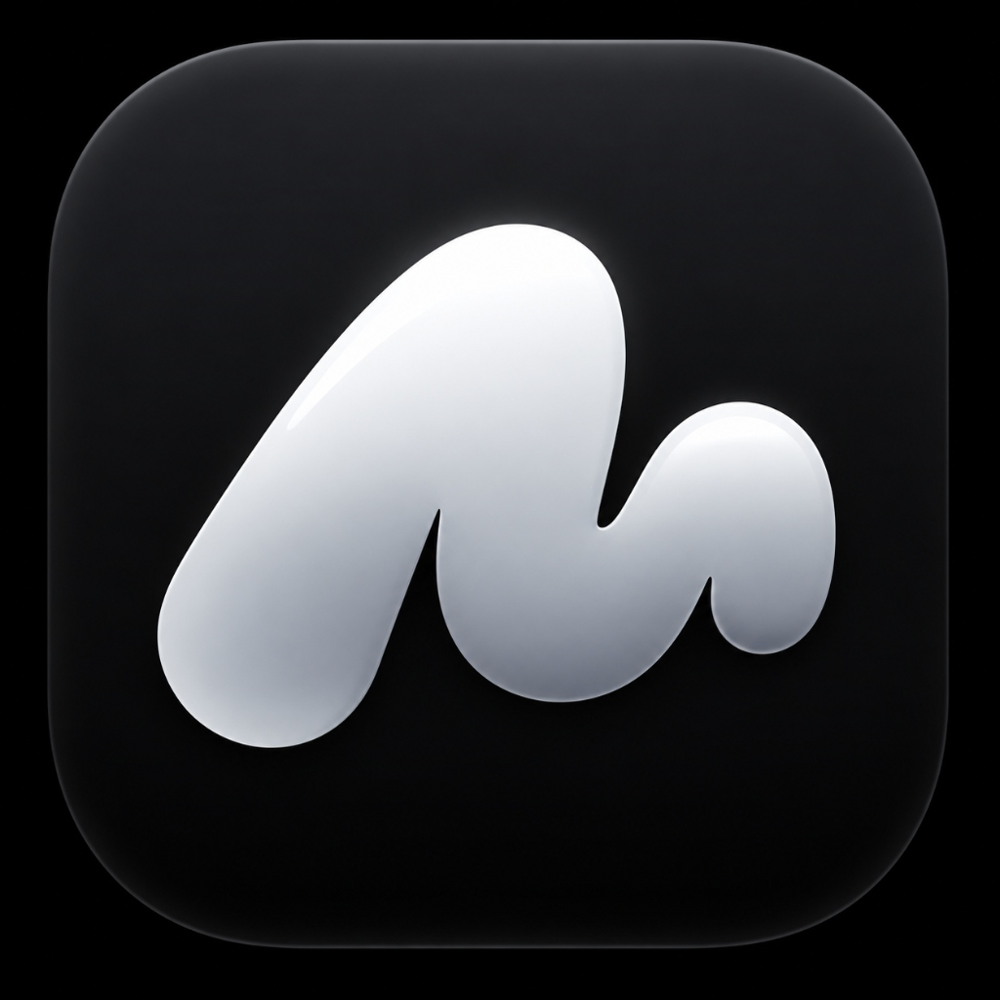
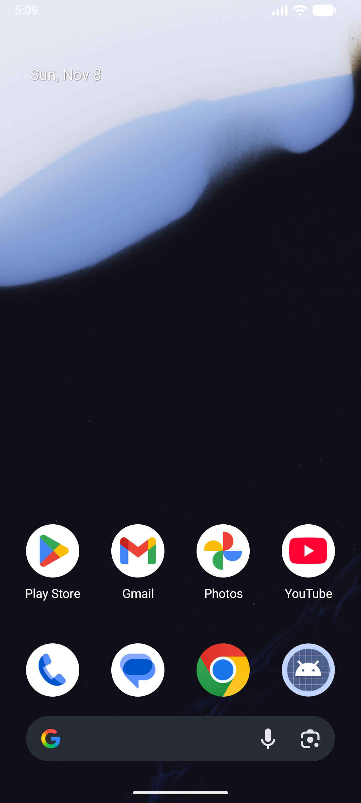
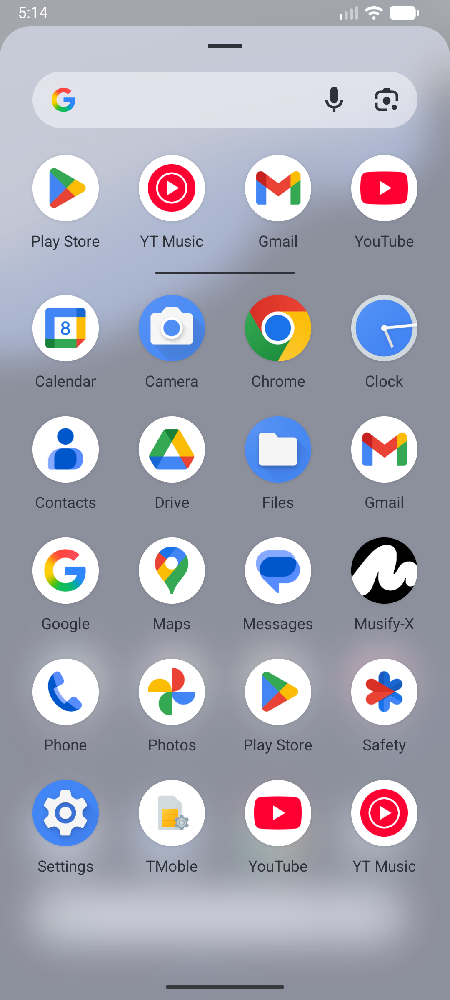
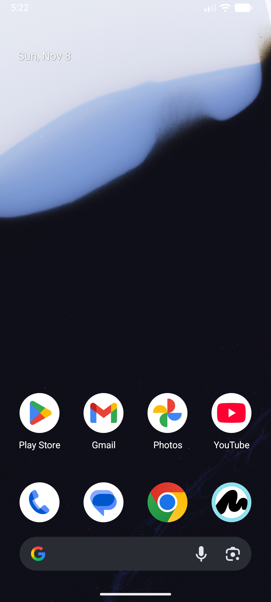
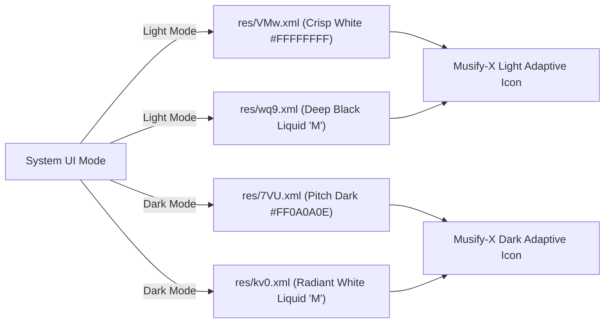
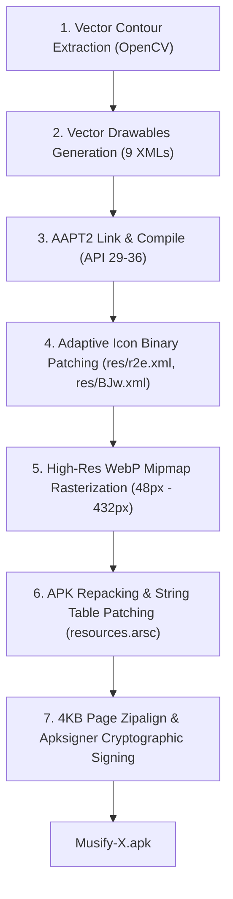

<div align="center">



# 🌐 Musify-X

### The High-Performance, Zero-Telemetry Privacy Browser for Android

**Powered by Chromium/Brave Engine · Dynamic Day/Night Adaptive Icons · Engine-Level Shields · Liquid 'M' Design System**

[](LICENSE)
[](#-quick-start)
[](#-architecture--engine)
[](#-dynamic-daynight-adaptive-icon-system)
[](https://github.com/adishxm)
[](#-build--installation)

<br/>

[**✨ Key Features**](#-key-features) • [**🌓 Dynamic Adaptive Icons**](#-dynamic-daynight-adaptive-icon-system) • [**📸 Screenshots**](#-visual-showcase) • [**🛠️ Build Pipeline**](#-build-pipeline) • [**🚀 Quick Start**](#-quick-start) • [**📂 Project Structure**](#-project-structure)

</div>

---

> [!IMPORTANT]
> **Musify-X vs Musify**: **Musify-X** is an independent, Chromium/Brave-powered mobile browser engineered specifically for modern privacy, high-speed rendering, and custom Day/Night vector iconography. It is completely distinct from the legacy Musify music player project.

---

## 📸 Visual Showcase

### 🌓 Dynamic Launcher & In-App Shields

| ☀️ Launcher (Light Mode) | 🌙 Launcher (Dark Mode) |
|:---:|:---:|
|  |  |
| *Solid white base circle with deep black liquid 'M'* | *Solid dark base circle with radiant white liquid 'M'* |

| 🛡️ In-App Shields (Light Mode) | 🛡️ In-App Shields (Dark Mode) |
|:---:|:---:|
|  |  |
| *Active liquid 'M' Shields button in navigation bar* | *Orange `#FFFF5601` liquid 'M' over dark browser chrome* |

| 📱 App Drawer (Light Theme) | 📱 App Drawer (Dark Theme) |
|:---:|:---:|
|  |  |

---

## ✨ Key Features

- 🛡️ **Zero-Telemetry Privacy Shields** — Native engine-level blocking of third-party ad networks, tracking beacons, cross-site trackers, and invasive fingerprinting scripts.
- 🌓 **Dynamic Day/Night Adaptive Launcher** — Custom Android Adaptive Icon engine that immediately transforms launcher iconography based on your device's system theme:
  - **Light Mode**: Crisp white circular disc with jet-black liquid 'M' foreground.
  - **Dark Mode**: Deep obsidian dark circular disc (`#0A0A0E`) with luminous liquid 'M' foreground.
- 🎨 **Liquid 'M' Design System** — Bespoke branding across the entire browsing experience:
  - **URL Bar Active Shields**: Vibrant orange (`#FFFF5601`) liquid 'M' vector button.
  - **URL Bar Inactive Shields**: Neutral subtle grey (`#FF888888`) liquid 'M' vector button.
  - **Splash & Onboarding**: Clean white liquid 'M' brand vector.
- ⚡ **Full Chromium & Blink Performance** — Powered by the industry-leading Chromium/Brave rendering core, delivering peak JavaScript execution speeds, instant page rendering, and standard compliance.
- 🎵 **Uninterrupted Background Web Media** — Eliminates synthetic tab freezes and background audio playback pauses, allowing stutter-free playback on web audio and streaming portals.
- 🔒 **No Cloud Lock-In & Zero Data Retention** — Your browsing history, bookmarks, tabs, and preferences reside strictly on your local hardware.

---

## 🌓 Dynamic Day/Night Adaptive Icon System

Android Adaptive Icons utilize two distinct layers (`<background>` and `<foreground>`). Musify-X introduces a dynamic, resource-backed configuration:



1. **Background Layer (`@0x7f0909b8`)**:
   - Day configuration dynamically routes to `res/VMw.xml` (Solid White `#FFFFFFFF`).
   - Night configuration dynamically routes to `res/7VU.xml` (Obsidian Dark `#FF0A0A0E`).
2. **Foreground Layer (`@0x7f0909c7`)**:
   - Day configuration dynamically routes to `res/wq9.xml` (Jet Black vector contour).
   - Night configuration dynamically routes to `res/kv0.xml` (Luminous White vector contour).
3. **Monochrome Themed Layer**:
   - Matches Android 13+ material dynamic theming using identical high-precision vector contours.

---

## 🛠️ Build Pipeline

Musify-X features an automated, standalone build orchestrator implemented in [`build.py`](build.py):



### Stage Summary
1. **Contour Extraction**: Uses OpenCV and Pillow to trace vector curves directly from the official transparent liquid 'M' asset (`assets/icons/logo-white-transparent.png`).
2. **Dynamic Drawables**: Generates 9 vector XMLs scaled for 24dp (URL bar), 108dp (launcher), 168dp, and 288dp (splash screen).
3. **AAPT2 Compilation**: Compiles the vector XMLs into binary format targeting Android API 29 through API 36.
4. **Adaptive Icon Patching**: Modifies binary offsets within `res/r2e.xml` and `res/BJw.xml` to link to dynamic Day/Night drawable references.
5. **Raster Mipmap Generation**: Renders multi-density WebP icons (`mdpi`, `hdpi`, `xhdpi`, `xxhdpi`, `xxxhdpi`) with anti-aliased circular clipping.
6. **Repacking**: Replaces raw resources in the ZIP archive and updates application strings in `resources.arsc` to `Musify-X`.
7. **Zipalign & Sign**: Aligns memory boundaries to 4-byte boundaries with `zipalign -p -f 4` and signs using `apksigner`.

---

## 🚀 Quick Start

### 1. Prerequisites
- **Python**: 3.10+
- **Android SDK**: Build-Tools (e.g. `34.0.0` or `36.1.0`) and Platform (`android-34` or higher)
- **Python Packages**:
  ```bash
  pip install pillow opencv-python numpy
  ```

### 2. Build Musify-X APK
Run the build script from the project root:
```bash
python build.py
```
Upon completion, the signed package is generated at `./Musify-X.apk`.

### 3. Launch & Test on Android Emulator
You can launch the emulator or perform an automated install & smoke test directly:

- **Launch Emulator**:
  ```cmd
  launch-emulator.bat
  ```
- **Automated Install & Verify**:
  ```cmd
  test-on-emulator.bat
  ```

---

## 📂 Project Structure

```
Musify-X/
├── assets/
│   ├── icons/
│   │   ├── musifyx-squircle-dark.jpg    # Official brand icon tile
│   │   ├── logo-white-transparent.png   # Transparent white liquid 'M'
│   │   ├── logo-black-transparent.png   # Transparent black liquid 'M'
│   │   ├── logo-white-black-bg.jpg      # White on black variant
│   │   └── logo-black-white-bg.jpg      # Black on white variant
│   └── screenshots/
│       ├── launcher_light.png           # Emulator verified light launcher
│       ├── launcher_dark.png            # Emulator verified dark launcher
│       ├── inapp_light.png              # Emulator verified light in-app shields
│       ├── inapp_dark.png               # Emulator verified dark in-app shields
│       ├── drawer_light.png             # Emulator verified light app drawer
│       └── drawer_dark.png              # Emulator verified dark app drawer
├── .gitattributes                       # Git line-ending normalizations
├── .gitignore                           # Excludes large binaries (>100MB) & cache
├── build.py                             # Standalone Musify-X build & signing engine
├── launch-emulator.bat                  # Fast emulator launcher with lock recovery
├── test-on-emulator.bat                 # Automated installation and testing script
├── CONTRIBUTING.md                      # Contribution guidelines
├── LICENSE                              # Apache 2.0 open-source license
└── README.md                            # Project documentation
```

---

## 📄 License

Musify-X is licensed under the [Apache License 2.0](LICENSE).

---

<div align="center">
  <b>Designed & Engineered with ❤️ by <a href="https://github.com/adishxm">adishxm</a></b>
</div>
